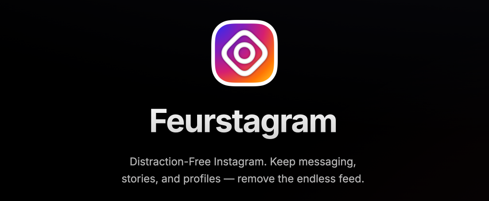
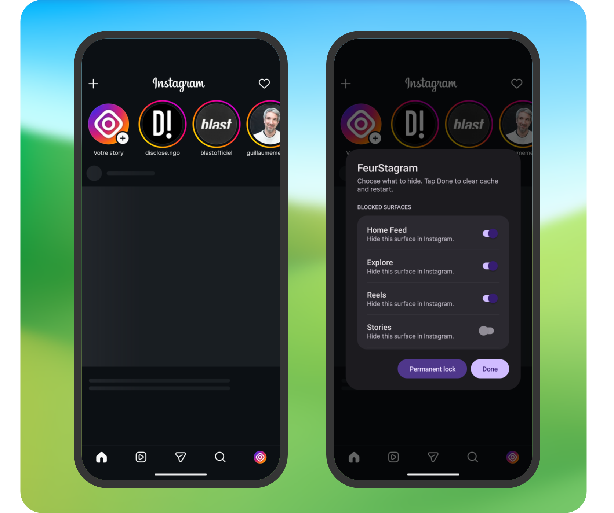
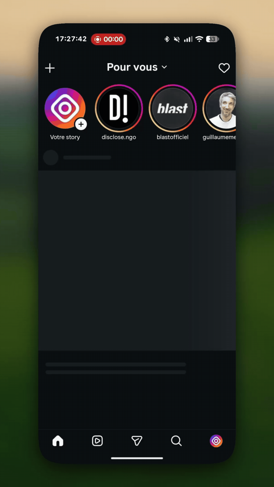

<div align="center">
  
  <h1>Feurstagram</h1>
  <p><strong>Instagram without Reels, feed, Explore or ads.</strong></p>
  <p>
    Feurstagram is <a href="https://jean-voila.github.io/FeurStagram/instagram-without-reels/">Instagram without Reels</a>:
    an open-source patch for the official Android app that removes the feed,
    Reels, Explore, ads and telemetry, while keeping DMs, stories, search,
    notifications and profiles.
  </p>
</div>

<p align="center">
  <a href="https://github.com/jean-voila/Feurstagram/releases/latest"></a>
  <a href="https://github.com/jean-voila/Feurstagram/releases/latest"></a>
  <a href="LICENSE"></a>
  <a href="https://discord.gg/Z9QvMw8s76"></a>
  <a href="https://www.instagram.com/feurstagram_off/"></a>
</p>

<p align="center">
  <a href="https://github.com/sponsors/jean-voila"></a>
  <br><br>
  <a href="https://buymeacoffee.com/jean_voila"></a>
</p>
<p align="center">
  
</p>

<p align="center">
  <a href="https://github.com/jean-voila/Feurstagram/releases/latest"><strong>Download APK</strong></a>
  ·
  <a href="docs/INSTALL.md">Install</a>
  ·
  <a href="docs/BUILD_FROM_SOURCE.md">Build from source</a>
  ·
  <a href="docs/FAQ.md">FAQ</a>
  ·
  <a href="docs/PRIVACY.md">Privacy</a>
  ·
  <a href="https://github.com/sponsors/jean-voila">Support</a>
  ·
  <a href="https://buymeacoffee.com/jean_voila">Buy me a coffee</a>
  ·
  <a href="https://github.com/jean-voila/Feurstagram/issues">Issues</a>
</p>

<p align="center">
  
</p>

## What it keeps and blocks

| Keep using Instagram for | Remove or block                               |
| ------------------------ | --------------------------------------------- |
| Direct Messages          | Endless Home feed                             |
| Stories                  | Reels surfaces                                |
| Search and profiles      | Explore and suggested-account recommendations |
| Notifications            | Ads, shopping preloads, and telemetry         |

## Preview

<p align="center">
  
</p>

<p align="center">
  
</p>

## Is it safe?

Feurstagram does not collect, proxy, store, or transmit your credentials.

It patches the official Instagram Android app to remove distracting features. The patches are open source and documented, so you can inspect what is changed.

For maximum trust, you can build the APK yourself instead of downloading a prebuilt release.

That said, Feurstagram is an unofficial project and is not affiliated with Instagram or Meta. It is a modified APK installed outside the Play Store, so Android may show installation warnings. Using a modified client may violate Instagram's terms of service. Use it at your own risk.

## What Feurstagram does NOT do

Feurstagram does not:

- bypass Instagram login;
- collect your password or session tokens;
- proxy your traffic through a third-party server;
- add tracking or analytics;
- scrape accounts;
- sell or transmit user data;
- claim affiliation with Instagram or Meta.

## Why Feurstagram?

Unlike WebView-based alternatives, Feurstagram patches the real Android Instagram app.

Unlike accessibility-service blockers, it does not simply react to the interface after it loads.

Unlike closed-source Instagram mods, every patch is public and auditable.

Feurstagram is built for people who want to keep Instagram's useful social features without the addictive parts.

I built this project for myself as an alternative to [DFInstagram](https://www.distractionfreeapps.com/) which hasn't been maintained for a long time and was difficult to update. I'm sharing it so others can do the same for themselves.

**This project is entirely free and open-source.** Feel free to fork, copy, enhance, or submit pull requests - do whatever you want with it!

## Documentation

- [Installation guide](docs/INSTALL.md)
- [Build from source](docs/BUILD_FROM_SOURCE.md)
- [Prepare and build on Linux (French)](docs/SETUP_LINUX.md)
- [Rebuild for a new Instagram version (French)](docs/REBUILD_VERSION.md)
- [FAQ](docs/FAQ.md)
- [Privacy](docs/PRIVACY.md)
- [Maintenance history](docs/maintenance/HISTORIQUE_MODIFICATIONS.md)
- [Improvement backlog](docs/maintenance/AMELIORATIONS_A_FAIRE.md)
- [Contributing](CONTRIBUTING.md)
- [Security policy](SECURITY.md)

## How do I update Feurstagram?

Feurstagram does not check GitHub or download app code from the app. Updates are
manual: download a release yourself, or rebuild the APK locally from source and
install it. The in-app Updates section only explains this; it makes no network
requests.

There is also a story on **the official Feurstagram** account every time there
is an update. Feurstagram has moved to a **new account**, @feurstagram_off:

- https://www.instagram.com/feurstagram_off/

Just follow this account and you will get a new story on each release.

## Community

Join the Discord server to get support, follow updates, and discuss development:

- https://discord.gg/Z9QvMw8s76

## Contact

Official email: **[feurstagram@gmail.com](mailto:feurstagram@gmail.com)**. Journalists can find facts, screenshots and logos in the [press kit](https://jean-voila.github.io/FeurStagram/press/).

## Installation

You have two options:

1. **Ready-to-install APK** - Grab the latest patched APK from the [Releases](../../releases) page and install it directly
2. **DIY Patching** - Use the toolkit below to patch any Instagram version yourself

## What Gets Disabled

All content blocks are **individual runtime toggles** — long-press Home (or
the first visible tab if Home is hidden) to open Feurstagram settings. Profile
has a second long-press shortcut when its tab is shown. A single APK covers
every combination.

| Feature                            | Default   | Toggleable | How                                                                                          |
| ---------------------------------- | --------- | ---------- | -------------------------------------------------------------------------------------------- |
| **Home Feed**                      | Blocked   | Yes        | Network-level blocking                                                                       |
| **Following feed only**            | Off       | Yes        | Feed-request header rewrite                                                                  |
| **Explore**                        | Blocked   | Yes        | Network-level blocking                                                                       |
| **Reels tab content**              | Blocked   | Yes        | Network-level blocking; the tab icon is a separate navigation toggle                         |
| **Recommended Reels in Home feed** | Blocked   | Yes        | Feed-item filtering; follows the Suggested toggle until changed independently                |
| **Reels shared in messages**       | Available | No         | Kept working; current request hooks cannot distinguish these safely from other shared videos |
| **Stories tray**                   | Visible   | Yes        | Network-level blocking                                                                       |
| **Opening Stories**                | Allowed   | Yes        | Separate Story-viewer request toggle                                                         |
| **Suggested accounts**             | Blocked   | Yes        | Network-level + feed-parse blocking                                                          |
| **Instants (+ button in DMs)**     | Blocked   | Yes        | View visibility hidden                                                                       |
| **Notes (text bubbles above DMs)** | Blocked   | Yes        | View visibility hidden                                                                       |
| **Ads**                            | Blocked   | Yes        | Network-level + feed-parse blocking                                                          |
| **Analytics & telemetry**          | Blocked   | No         | Always blocked                                                                               |
| **Shopping / commerce preloads**   | Blocked   | No         | Always blocked                                                                               |

**Following feed only** is a softer alternative to blocking the Home Feed
entirely: leave the feed unblocked and turn this on to get a chronological feed
of just the accounts you follow, with the recommended/ranked posts dropped.

The **Profiles** page offers three starting points: **Messages only** blocks
browsing surfaces and leaves Messages available; **Following only** keeps a
following-only Home feed and the Stories tray; **Strict mode** blocks the feed,
discovery and Story entry points. Before applying one, the app lists every
setting it will replace and asks for confirmation. A profile changes only the
listed Feurstagram content and navigation preferences; it does not change
credentials, Instagram data, display preferences, landing page or permanent
lock. All settings remain individually editable afterward.

## What Still Works

| Feature                 | Status                                               |
| ----------------------- | ---------------------------------------------------- |
| **Direct Messages**     | Works                                                |
| **Profile**             | Works                                                |
| **Reels shared in DMs** | Works; deliberately not blocked by the Reels toggles |
| **Search**              | Works                                                |
| **Notifications**       | Works                                                |
| **Deep links**          | Works                                                |

## Settings Page

**Long-press the Home tab** (the house icon at the bottom-left of Instagram's
main tab bar). If you hid Home, long-press the first visible tab; when shown,
Profile is an alternative shortcut. A full-screen, scrollable settings page
opens — Material 3 Expressive, monochrome, and padded to fit around system bars
and cutouts on any device. It starts on an overview: one row per section, with
Instagram's own outline icon and a one-line summary of that section's current
state (for example "3 of 12 hidden"). Tapping a row opens the section's page in
the same window, with a back arrow; Back returns to the overview. The sections
are:

- **Experimental feature: Quoicouview mode** (off by default) — Messages becomes
  the main page, with the stories tray at the top of the inbox, under its search
  bar, and the notifications button in its header, and Home is turned off. The
  story camera opens from the tray's "Your story" (+) or with a swipe to the
  right, as on Home. A card presents it once after the update, with a screenshot.

- **Profiles** — preview and apply Messages only, Following only, or Strict
  mode. The confirmation lists every setting that will be replaced; all other
  preferences stay unchanged.
- **Blocked surfaces** — separate toggles for Reels tab content, recommended
  Reels in the Home feed, Stories tray, and Story opening, plus Home Feed,
  Explore, Suggested accounts, Ads, Instants, and Notes. The Reels navigation
  icon remains a separate toggle.
- **Navigation bar** — show or hide each bottom-bar icon (Home, Search, Reels,
  Create, Messages, Profile) independently of the content blocks, with a live
  preview of the bar above the toggles. A toggle for a tab your Instagram build
  does not have (451 has no Create tab) is greyed out. Hiding Home moves the
  settings gesture to the first icon left on the bar, and Instagram then opens
  on that icon instead of the hidden feed; Home stays if every other icon is
  hidden, so the settings remain reachable. Long-press Profile is a second shortcut
  while that tab is shown. A swipe that would land on a hidden tab carries
  straight on to the next visible one, so a hidden section stays hidden instead
  of being one flick away.
- **Feed** — _Following feed only_: restrict the Home Feed to accounts you
  follow (chronological), instead of the recommended feed. Has effect only when
  the Home Feed is left unblocked.
- **Display and popups** — _Force dark (disable HDR)_ (on by default): stops Instagram
  forcing its window into HDR mode, which lifts the black floor and washes out
  the dark UI on HDR OLED screens. Turn it off to keep Instagram's HDR behaviour.
  _Instagram popups_ (on by default) drops **all** Instagram toast popups, not
  only "Couldn't refresh feed" messages caused by blocked surfaces. This can
  also hide unrelated network errors or useful status messages; turn the option
  off here if you need to see them. The current Instagram hook cannot reliably
  tell which request caused a popup or classify its message across languages.
- **Landing page** — choose which surface the app jumps to on cold start
  (Home feed, Search, Direct messages, or Profile). A surface whose navigation
  icon is hidden can't be picked, and stops being used if you hide it later:
  landing on it would hand back exactly what you removed. Instagram then opens
  on the Home feed, or on the first icon of the bar if Home is hidden too.
- **Updates** — manual only. Feurstagram does not poll GitHub, fetch release
  notes, or download APKs from within the app. Build a new APK locally or
  deliberately obtain a release yourself.
- **Support** — opens the project's [GitHub Sponsors](https://github.com/sponsors/jean-voila) page.
- **Permanent lock** and **Done** buttons pinned at the bottom so they stay
  reachable on any screen size.

Changes persist across restarts (stored in SharedPreferences
`feurstagram_prefs`).
Android cloud backup and device-to-device transfer include this preferences
file while preserving Instagram's existing backup rules. Restoring it depends
on the Android/Huawei backup service and its account/settings; an update signed
with the same key preserves data directly, while uninstalling can still erase
local data if no backup was made.

Once you change any setting, the page can only be left by restarting: both
**Done** and **Back** clear the cache and relaunch, so a changed block can
never leave the app in a half-applied state with stale content still loaded.
If you open the page and change nothing, Back simply closes it.

### Permanent lock

The permanent lock freezes your restrictions for this installation. It only
prevents _relaxing_ them: you can still make settings **stricter** (turn a
block on), but you cannot turn a block back off without reinstalling.
Enabling it now requires a separate confirmation and typing `LOCK`. It freezes
content blocks and navigation icons already hidden when the settings page was
opened. There is no in-app unlock; uninstalling and reinstalling may erase
local app data, so do not enable it unless you accept that recovery cost.

The freeze is captured per settings session, not the instant you flip a
switch. When you open the settings page, Feurstagram snapshots which surfaces
are currently blocked; only those stay frozen. A surface you turn on by
mistake during a session can still be turned back off **until you tap Done** —
Done clears the cache and restarts, which bakes the new state in as the next
snapshot. This means a stray tap on a surface (e.g. Stories) is recoverable
within the same session instead of forcing a reinstall.

## Requirements

- JDK 21 and the Android SDK (`ANDROID_HOME` set, build-tools installed)
- Morphe CLI and APKEditor (for split bundles) in `tools/`
- Gradle distribution and dependencies already cached locally; `build.sh`
  invokes Gradle with `--offline` and fails if anything is missing
- No GitHub token is required by the local build

## Build from source

1. **Obtain a compatible Instagram APK** from a source you trust. Keep local
   APK/APKM inputs in the ignored `build/inputs/` directory (create it if needed).

2. **Build and apply:**
   ```bash
   ./build.sh build/inputs/instagram.apk
   ```
   Add `--clone` to install Feurstagram **alongside** a stock Instagram (separate
   package and data), and `--install` to push it to a connected device:
   ```bash
   ./build.sh build/inputs/instagram.apk --clone --install
   ```
   The signed result is written to `build/outputs/feurstagram.apk`.
   `--debug` writes a separate `build/outputs/feurstagram-debug.apk`; it enables
   the ADB debug bridge and must not be distributed.

## Project structure

```
Feurstagram/
├── extensions/                   # Android runtime extension (Java)
├── patches/                      # APK patch definitions (Kotlin)
├── gradle/                       # Gradle Wrapper and dependency catalog
├── tools/                        # Local patcher tools; ignored by Git
├── build/                        # Local inputs, intermediates, reports, APK outputs
├── docs/                         # User guides and published project website
│   └── maintenance/              # Local project history and improvement backlog
├── assets/                       # Repository-level social preview assets
├── .github/                      # Issue and release templates
├── build.sh                      # Offline build and APK patch pipeline
└── README.md                     # Project overview and entry point
```

Local Instagram APKs belong in `build/inputs/`. Merged APKs and other
intermediates belong in `build/intermediates/`, patch reports in `build/reports/`,
and generated Feurstagram APKs in `build/outputs/`. The entire `build/` tree is
ignored by Git and should not be committed.

## Design

Feurstagram's own screens follow Material 3 Expressive in a monochrome dark scheme —
white is the only accent, and everything is built in code because the mod has no
resources of its own. The tokens, shapes, type scale, component rules and the
window-inset requirements are written down in [docs/DESIGN.md](docs/DESIGN.md); read it
before changing or adding any UI.

## Signing

The bundle is signed during `build.sh`. Set `FEURSTAGRAM_KEYSTORE_PASS` (and
optionally `FEURSTAGRAM_KEY_PASS`) to sign with `feurstagram.keystore`;
otherwise a throwaway keystore is generated. Reuse the same keystore across
builds to install updates without uninstalling first.

For the full release workflow, see [docs/maintenance/DEPLOIEMENT_MISE_A_JOUR.md](docs/maintenance/DEPLOIEMENT_MISE_A_JOUR.md). To generate a ready-to-publish update bundle, run [scripts/publish_update.sh](scripts/publish_update.sh).

## Debugging

Blocked requests surface as `java.io.IOException: Blocked by Feurstagram` in
logcat:

```bash
adb logcat | grep "Blocked by Feurstagram"
```

## How It Works

Patches locate their injection points by **fingerprint** (matching code by
stable traits like class names, strings and method shapes) rather than by
obfuscated names, so they keep applying across Instagram updates. The runtime
logic lives in compiled extension classes that are merged into the app.

### Settings Hook

A fingerprint matches the main tab-bar binder and injects a watcher on it. The
watcher resolves the tab ids via `Resources.getIdentifier(...)`, grabs the
Home tab (or the first visible tab when Home is hidden) once laid out, and
installs a long-press listener. Long-pressing
opens a full-screen Material dark page: content toggles plus a landing-page
selector, all backed by `SharedPreferences` (`feurstagram_prefs`). The same
hook installs the navigation-tab/Notes/Instants hiders, the hidden-tab swipe
skipper and the cold-start landing-page redirect.

### Quoicouview mode

The Direct inbox is an `IgRecyclerViewAdapter`: a list of models, each drawn by
the row type registered for its class. The patch registers one more row type,
`StoriesTrayRow`, in every such adapter (it is made a subclass of Instagram's
obfuscated row and holder base classes at patch time), and hooks the adapter's
list updates so the inbox's list gets the stories row right after its search
bar (the search bar's obfuscated list models are found at patch time). The row holds the
feed's own stories tray: Instagram keeps every tab's page alive, so the feed
keeps the tray up to date while it is drawn in the inbox. A tap opens the story
exactly as on Home, growing out of the avatar and shrinking back into it on
close: the feed tray controller's "is the feed visible" checks accept the tray
in the inbox, and the controller, a lifecycle listener of the feed fragment,
follows the inbox's resume and pause instead. The viewer is added over the
inbox rather than replacing it, so closing it does not wait for the inbox to be
rebuilt. The feed header's notifications
button is moved to the inbox header the same way. The story camera is the swipe
navigation's panel left of the tab pages, which Instagram only turns on, and only
lets a swipe from the main page reach, while Home is the current tab: both "is
Home current" checks of the tab controller accept Messages, and the tab pager
tells the swipe navigation it cannot scroll onto the hidden pages left of
Messages, so the tray's "Your story" (+) and a swipe to the right open the camera. A third patch keeps the hidden
Home out of the tab Back history.

### Network Blocking

A fingerprint matches `TigonServiceLayer.startRequest` (a named class) and
injects a call on the request URI. Blocked calls throw an `IOException`, so the
surface fails to load and stays empty.

### Feed Item Filtering

Network blocking can't touch ads and "suggested" units that Instagram injects
**inline** into the Home Feed payload — they arrive inside the normal
`/feed/timeline/` response, not on a separate URL. A second fingerprint matches
the feed-item JSON deserialiser (by the stable wire-format type tokens like
`clips_netego` and the `parseFromJson` method name) and rewrites a blocked
unit's type token to an invalid one. Instagram's own parser then routes it to
its "unknown FeedItem type" branch and drops it — no crash. Ad/promo units are
gated on the **Ads** toggle, suggested/netego units on the **Suggested
accounts** toggle.

### Following Feed Only

A fingerprint matches the main-feed request class (by its debug-string shape)
and rewrites the request's `pagination_source` header from the recommended feed
to `following`, so the Home Feed returns only accounts you follow. The header
field is obfuscated, so it is resolved dynamically each build rather than
hardcoded. Gated on the **Following feed only** toggle.

### Deep-link signature bypass

Instagram checks that the running APK is signed by Meta before it follows a deep
link into its own content. A re-signed FeurStagram build fails that check, so
shared links (posts, reels, profiles) may fall back to the home feed. The
signature-scope bypass is **disabled by default**: it replaces Instagram's
family-app scope check with `true` for every caller, not only the deep-link
resolver. Enabling it weakens caller trust and may affect routes beyond shared
links; do so only in a test build when that trade-off is acceptable. The
separate global self-signature allowlist check remains unchanged. Build
compatibility is recorded in the
[Instagram version matrix](docs/maintenance/COMPATIBILITE_INSTAGRAM.md), but
link routing and authentication still need device testing for each version.
Fixes #36 and #106.

### Force SDR display

Instagram switches its window into HDR mode at runtime (server-gated per
account), which lifts the black floor on HDR OLED panels and leaves the flat dark
UI looking washed out for no benefit. A patch reroutes every window colour-mode
change through an extension helper that pins the window to SDR when the **Force
dark** toggle is on (default), keeping blacks deep; turning it off passes
Instagram's original colour mode through untouched. It hooks the framework
`Window.setColorMode` call, so it too needs no per-version maintenance.

Suggested accounts mixed into the story tray are not a separate request: they arrive as
`reel_type: "suggested_user"` entries of the tray response itself. A parse-layer hook drops
them when _Suggested accounts_ is blocked, the same way feed ads are filtered.

#### Blocked network paths

| Path / pattern                                                                                                                                                                                                                                                                                                                                                                                                                                                                                                                                                                                             | Purpose                                                                                                                                                                    | Toggleable |
| ---------------------------------------------------------------------------------------------------------------------------------------------------------------------------------------------------------------------------------------------------------------------------------------------------------------------------------------------------------------------------------------------------------------------------------------------------------------------------------------------------------------------------------------------------------------------------------------------------------- | -------------------------------------------------------------------------------------------------------------------------------------------------------------------------- | ---------- |
| `/feed/timeline/`                                                                                                                                                                                                                                                                                                                                                                                                                                                                                                                                                                                          | Home feed posts                                                                                                                                                            | Yes        |
| `/feed/reels_tray`                                                                                                                                                                                                                                                                                                                                                                                                                                                                                                                                                                                         | Stories tray                                                                                                                                                               | Yes        |
| `/feed/user/.../story/`, `/feed/reels_media/`                                                                                                                                                                                                                                                                                                                                                                                                                                                                                                                                                              | Opening a Story                                                                                                                                                            | Yes        |
| `/discover/topical_explore`                                                                                                                                                                                                                                                                                                                                                                                                                                                                                                                                                                                | Explore tab content                                                                                                                                                        | Yes        |
| `/clips/home/`, `/clips/discover`, `/clips/get_blend_medias/`                                                                                                                                                                                                                                                                                                                                                                                                                                                                                                                                              | Reels tab feed + discovery + Blend reels                                                                                                                                   | Yes        |
| `clips_netego` feed units                                                                                                                                                                                                                                                                                                                                                                                                                                                                                                                                                                                  | Recommended Reels mixed into Home                                                                                                                                          | Yes        |
| `/discover/ayml/`, `/discover/sectioned_ayml/`, `/discover/chaining/`, `/discover/recommended_accounts_for_category/`, `/discover/suggested_businesses/`, `/discover/recs_from_friends_suggestions/`, `/discover/recs_from_friends_user_info/`, `/discover/surface_with_su/`, `/discover/fetch_suggestion_details/`, `/discover/account_discovery/`, `/discover/reshare_suggestions/`, `/fbsearch/accounts_recs/`, `/friendships/feed_favorites_suggestions/`, `/friendships/share_to_friends_story_suggested_users/`, `/direct_v2/search_friending_suggestions/`, `/business/discovery/suggest_business/` | Suggested-account recommendations (profile "Suggested for you", stories-tray injected accounts, search null-state recs, post-follow chaining, friend/business suggestions) | Yes        |
| `/api/v1/ads/` (all `ads/*`), `/feed/async_ads_ranking/`, `/feed/shop_everything_feed_of_ads*`, `/feed/user_interests_contextual_feed_of_ads/`, `/discover/chaining_experience_contextual_ads/`, `/discover/chaining_experience_notification_ads/`, `/direct_v2/ads_for_ctd_ads_thread_view/`, `/direct_v2/should_show_ad_responses_tab/`, `/profile_ads/get_profile_ads/`, `/stories/stories_high_intent_discovery_ads/`, `/stories/stories_intent_aware_ads/`, `/commerce/product_collections/ads_collection_page/`                                                                                      | Sponsored ads injected into the feed, stories, profile, DMs, Explore chaining and commerce                                                                                 | Yes        |
| `/logging/`                                                                                                                                                                                                                                                                                                                                                                                                                                                                                                                                                                                                | Client event logging                                                                                                                                                       | No         |
| `/async_ads_privacy/`                                                                                                                                                                                                                                                                                                                                                                                                                                                                                                                                                                                      | Ad-related tracking                                                                                                                                                        | No         |
| `/async_critical_notices/`                                                                                                                                                                                                                                                                                                                                                                                                                                                                                                                                                                                 | Engagement nudge analytics                                                                                                                                                 | No         |
| `/api/v1/media/.../seen/` (path contains `/api/v1/media/` and `/seen`)                                                                                                                                                                                                                                                                                                                                                                                                                                                                                                                                     | Post “seen” tracking                                                                                                                                                       | No         |
| `/api/v1/fbupload/`                                                                                                                                                                                                                                                                                                                                                                                                                                                                                                                                                                                        | Telemetry upload                                                                                                                                                           | No         |
| `/api/v1/stats/`                                                                                                                                                                                                                                                                                                                                                                                                                                                                                                                                                                                           | Performance / usage stats                                                                                                                                                  | No         |
| `/api/v1/commerce/`, `/api/v1/shopping/`, `/api/v1/sellable_items/`                                                                                                                                                                                                                                                                                                                                                                                                                                                                                                                                        | Shopping / commerce preloads                                                                                                                                               | No         |

Note: despite the name, `/feed/reels_tray` is the stories tray endpoint in Instagram internals.

Matching uses `String.contains()` on the URI path. Instagram changes URL shapes over time; adjust the rules in `extensions/.../Block.java` if a block stops matching.

## Updating for New Instagram Versions

Because patches are fingerprint-based, a new Instagram version usually just
needs a rebuild (`./build.sh build/inputs/<new-instagram.apk>`). If Instagram restructures a
targeted area, only the affected fingerprint needs adjusting.

## Contributing

This is a personal project I'm sharing with the community. Contributions are welcome!

- 🍴 **Fork it** - Make your own version
- 🔧 **Pull requests** - Improvements and fixes are appreciated
- 📋 **Copy it** - Use the code however you want
- ✨ **Enhance it** - Build something even better

## License

This project is released under the GNU General Public License v3.0. See [LICENSE](LICENSE) for details.

Built with the [Morphe](https://morphe.software) patcher and adapts Instagram
patch ideas from [Piko](https://github.com/crimera/piko), both GPLv3. See
[NOTICE](NOTICE) for attribution. Feurstagram is an independent project, not
affiliated with or endorsed by Morphe or Piko.
# feurstagram
